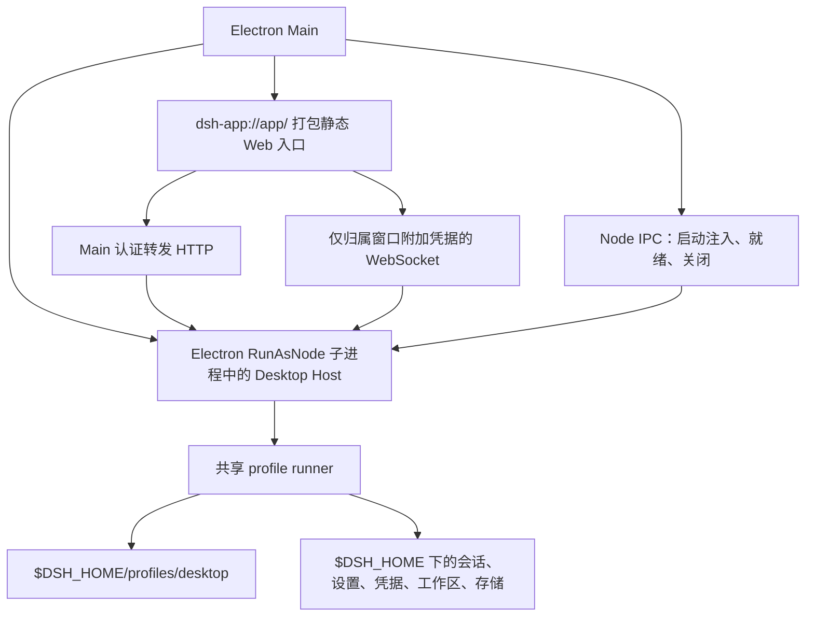
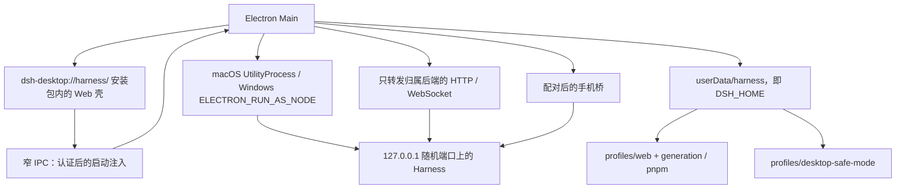
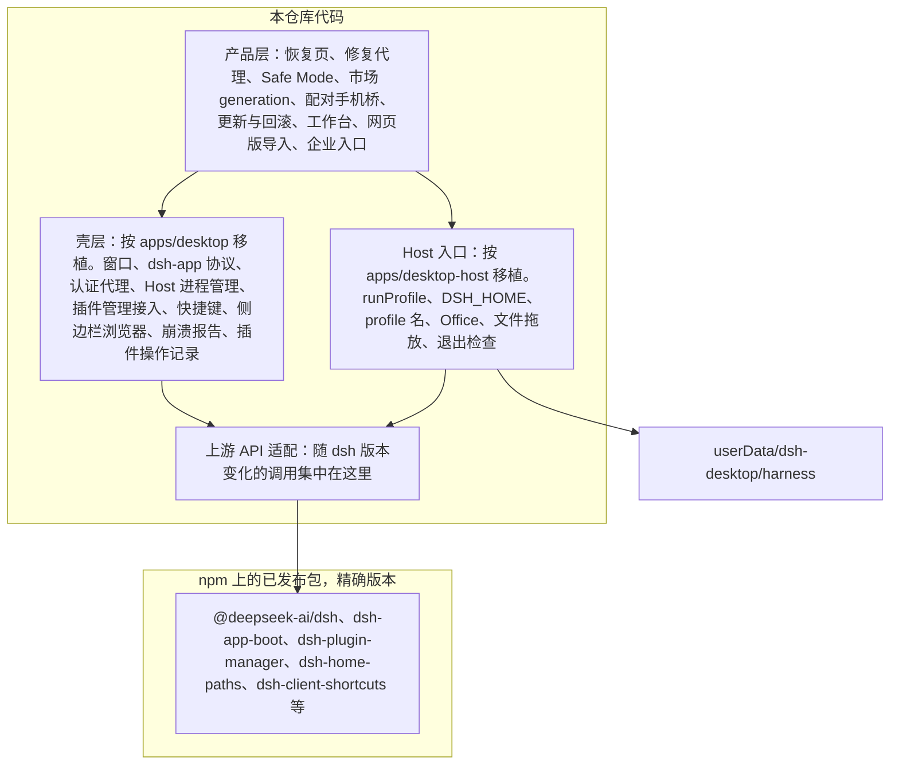
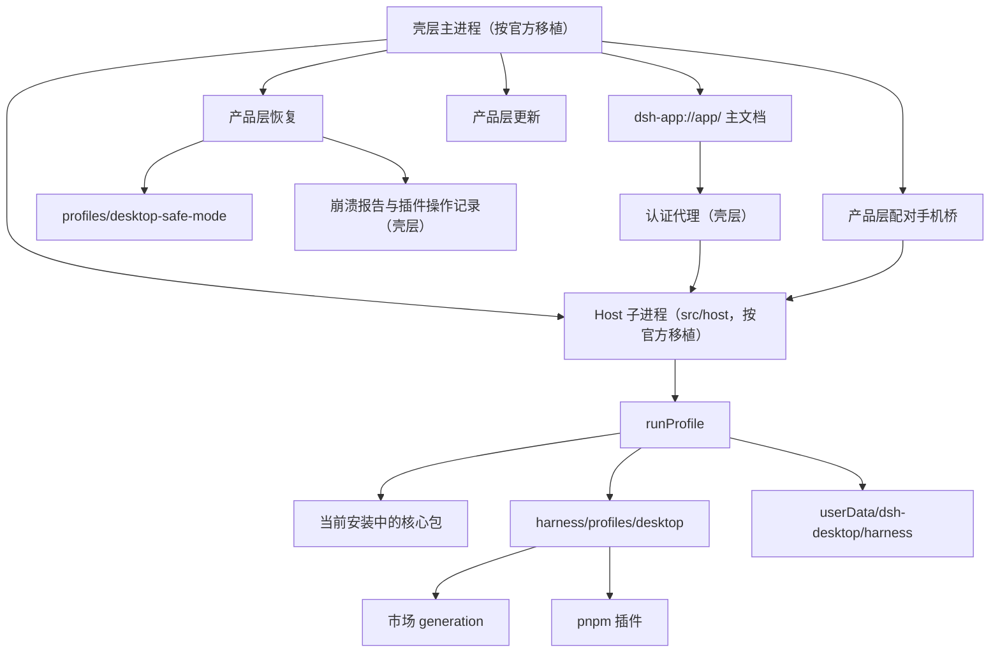

# 三套 Desktop 架构对照与迁移方案

文档日期：2026-11-05。本文比较官方 Desktop、当前仓库和 anywhere-labs/dsh-desktop，并给出迁移方案：以官方 `apps/desktop` 和 `apps/desktop-host` 的源码为底座，把当前产品的数据归属、恢复、市场、手机桥和更新迁上去。优劣、可行性、目标架构、迁移步骤、影响范围和风险都写在这里。不记录已经完成的代码改动。

## 1. 对照边界

| 侧 | 锚点 | 说明 |
| --- | --- | --- |
| 官方 Desktop | [deepseek-ai/deepseek-harness](https://github.com/deepseek-ai/deepseek-harness) tag [`dsh-v0.2.2-rc.1`](https://github.com/deepseek-ai/deepseek-harness/releases/tag/dsh-v0.2.2-rc.1)，提交 `66491b05e3f05ad35bcdd4f6cd7ed26041d9e3db`（2026-11-04） | `apps/desktop`、`apps/desktop-host` 的版本都是 `0.2.2-rc.1`。这个 tag 在发布分支上，不跟 `master` |
| 当前仓库 | 发布标签 `v0.13.2`（`78310787`，2026-11-03）。`main` 在其上还有 `8504fd59`。依赖 `@deepseek-ai/dsh@0.2.2-rc.1`（从 `main` 上的 `0.2.2-alpha.2` 升级，配套 Cordis `4.1.0`、Schemastery `3.19.0`） | 独立 npm 仓库，用 `patch-package` 修改已发布包。`package.json` 的 `version` 仍是 `0.12.1`；打 `v*` 标签时由 `.github/workflows/release.yml` 覆盖。已安装应用的版本是 `0.13.2`。数据根是 Electron `userData` 下的 `dsh-desktop/harness` |
| anywhere-labs | [anywhere-labs/dsh-desktop](https://github.com/anywhere-labs/dsh-desktop) `master` `a8b98656fd8bcaa888bcc63489b2ecda68a61084`（2026-11-04） | 外层 Yarn workspace。`deepseek-harness/` 是固定子模块，桌面功能不改子模块里的文件。一个仓库里有两种架构：Stable / Beta 的“桌面即插件”（`dsh-plugin-desktop`、`dsh-plugin-desktop-beta`），以及 Next（`dsh-desktop-next`）的官方派生薄壳。Beta 与 Next 都固定上游 `66491b05`（`0.2.2-rc.1`），Stable 固定 `1f81c047`（`0.2.1-rc.3`） |

anywhere-labs 的发布记录（2026-11-05 查询 GitHub Releases）：标为 Latest 的正式版是 `DSH NEXT v2.0.22-next`（2026-11-04），覆盖 Windows、macOS 和 Linux；Beta 只发预发布版；Stable 最后一次发布是 `v2.0.18`（2026-10-17）。所以它当前的主发布线是 Next，“桌面即插件”的 Stable / Beta 线不再是主发布线。仓库 `dsh-desktop-next/PLAN.md` 仍把 Next 写成“可运行的开发包”，与发布记录不一致；本文以发布记录和 Next 的 `README.zh.md` 为准。

官方 Desktop 指上游仓库里的 Electron 应用，不是本仓库，也不是本机已安装的 DSH Desktop。npm 上的 `@deepseek-ai/dsh` 不包含 `apps/desktop` 与 `apps/desktop-host`。本仓库通过已发布包和 `patches/` 消费 Harness；官方在同一 monorepo 里一起构建壳、Host 和 Web；anywhere-labs 把上游固定成子模块，在外面构建自己的壳。

几套 Desktop 都是 Electron 宿主加 Harness Web UI，都没有第二套 Agent runtime。差别在上游怎么固定、桌面能力放在哪、数据放在哪、插件和恢复怎么做。

[同机 Web 导入](web-to-desktop-migration.zh.md) 第 8 节写于 2026-09-11。当时官方还在讨论无端口字节管道。2026-09-10 的薄壳决策已经改回共享 HTTP。导入方案本身仍然有效；官方启动链以本文为准。

## 2. 三套架构

### 2.1 官方 Desktop

官方把 Desktop 定义成完整 dsh Web 应用外面的 Electron 壳。认证、HTTP 路由、客户端资源、RPC、响应流和插件管理都走 Web 的同一套实现。Electron 只拥有窗口、菜单、原生对话框、恢复对话框和发布更新。私有 `apps/desktop-host` 对独占的 Desktop profile 调用 CLI 的共享 profile runner。



发布身份上，Electron 壳、`@deepseek-ai/dsh` 和内置 pnpm 组成一个已签名更新单元，壳和 dsh 使用同一精确版本。签名资源里的 `desktop-runtime.json` 绑定壳版本、Electron 的 Node 版本、平台、架构、共享包版本和文件清单。

传输上，主窗口在后端启动之前用打包静态资源打开共享 Web 加载页。Host 在系统分配的 `127.0.0.1` 端口上提供已有 Web 服务。Electron 转发已认证的 HTTP，WebSocket 只给归属窗口附加凭据，认证 Cookie 不进任何 Electron session。Node IPC 只携带启动注入、就绪和关闭。插件管理走 Web 的认证 HTTP API。渲染进程拿不到文件系统、原始 Electron IPC、shell 或任意 pnpm 参数。

数据上，已安装应用默认和 `npx @deepseek-ai/dsh web` 共用 `$DSH_HOME`（显式配置，否则 `~/.dsh`）里的会话、设置、凭据和存储。Electron 独占 `profiles/desktop`。壳自己的状态放在 Electron `userData`，例如 `desktop/settings.json`。Windows 卸载会删除 Electron 用户数据和更新缓存，不删除 Harness 主目录。

核心包只在 `app.asar/dsh`。profile 只安装外部插件，不写 fallback 链接，也不启用 `--preserve-symlinks`。依赖解析使用 Harness 的 runtime resolution，规则见[解析顺序说明](https://github.com/deepseek-ai/deepseek-harness/blob/66491b05e3f05ad35bcdd4f6cd7ed26041d9e3db/.agents/notes/implemented/architecture/2026-09-19-profile-resolution-lookup-order.zh.md)：先走插件和 profile 自己的 `node_modules`；走到 `$DSH_HOME/profiles/node_modules` 时，运行时表里有的包名由当前安装占据；链接到 profile 树外的包，只有被声明为 peer 且运行时表里有同名条目时才改接；`exports` 拒绝某个子路径就是终局。

致命失败只打开一次原生对话框：退出、重启、禁用第三方 bundle 并备份 `cordis.patch.yml`、导出诊断。官方没有 profile 重置，也没有应急 HTML 恢复页。

Desktop 自带 Python、Node.js 和 pnpm。macOS 和 Linux 在第一个 Host 启动前读取一次登录 shell 环境。Windows 使用注册表环境。壳还拥有欢迎窗、关窗隐藏、可选 `dsh` 命令、更新渠道和租约范围内的侧边栏浏览器。更新含服务端强制策略；README 仍把账号登录写成已知限制。这些壳层产品行为说明官方把哪些状态留在壳里，当前产品不必逐项复制。

### 2.2 当前仓库

本仓库是 Harness 的 Electron 宿主，复用上游 runtime 和 Web UI。壳、补丁、市场、恢复和桌面产品能力都在这个独立仓库里，通过 npm 安装 `@deepseek-ai/dsh@0.2.2-rc.1`，再用 37 个 `patch-package` 补丁接上宿主需要的行为。



现行启动顺序见 [architecture.md](architecture.md) 和 [parallel-page-boot.md](parallel-page-boot.md)：固定应用身份和 `userData`，取得单实例锁，先打开 `dsh-desktop://harness/`，再修补 profile 的 pnpm store、做市场基线和 generation 投影，然后在随机回环端口启动 Harness。Main 认证后通过窄 IPC 注入启动数据。Cookie 不出现在页面 URL 里。

持久化根是 Electron `userData` 下的 `harness/`。正常 profile 名叫 `web`。第三方插件可以安装成不可变 generation，也可以留在 pnpm 共享树里。市场开关的权威记录是 `profiles/web/.dsh-market/state.json`。Safe Mode 使用同一 `DSH_HOME` 下的 `desktop-safe-mode`，只放官方核心 bundle，不删除正常 profile。

核心包解析已经有两层。上游 `dsh-app-boot` 在启动时创建 runtime resolution；`build/harness-node-entry.mjs` 在加载 dsh 之前注册 `build/host-module-fallback.mjs`，它排在上游钩子之后，只在上游也报 `ERR_MODULE_NOT_FOUND` 时，把 `@deepseek-ai/*` 改从安装目录再解析一次。这个回退不分 profile，Safe Mode 进程里也注册了。Safe Mode 的安装目录锚点另有来源：补丁后的 `mountRootInclude` 把根 Include 的导入基准指向安装目录，见 `test/safe-mode-host-resolved.test.ts`，它不依赖 `profiles/node_modules`。

新建的正常 profile 由上游 `initProfile` 生成，`dependencies` 为空，官方核心包只出现在 `dsh.profile.bundles` 里（`src/main/state/generation-launch.ts`）。profile 依赖里出现核心包，只可能来自旧版本留下的 profile，或从网页版导入的 `package.json`。

Harness 子进程由 `runtime.stop()` 和 `runtime.start()` 串行重启。`launchHarness()` 和 `launchSafeHarness()` 共用一个进行中的启动操作，先停旧进程再做 profile 维护；`HarnessRuntime` 用 `this.child === child` 丢弃过期子进程的事件，每次启动重新分配端口和启动令牌。Safe Mode 切换不重启 Electron。

壳还拥有社区插件市场与 generation、引导式插件恢复和修复代理、Safe Mode、手机局域网桥与可选隧道、PPT / Office 运行时、工作台，以及应用内更新回滚。企业入口目前只打开官网页面。

### 2.3 anywhere-labs

#### Stable / Beta：桌面即插件

桌面壳本身是一个 Cordis 插件，和第三方插件走同一套组合。Electron launcher 取得单实例锁，准备当前 profile，再启动一代 Host。窗口、托盘、导航限制和外链处理属于这一代 `ElectronShellGeneration`。切换 profile 或呈现模式时整代释放，不把窗口或子进程留到下一代。Web Client 成功加载后才创建托盘并记录这次 profile 可用（last-known-good）。

Electron 始终从回环地址在沙箱渲染进程里加载同源页面，没有 preload bridge，渲染进程拿不到 Electron API。Host 默认只绑回环；浏览器访问的局域网档要用户确认，走 HTTPS，访问设备先信任本机证书，再用访问链接连接。公开契约是 `desktopProfiles`、`desktopPnpm` 和客户端的 `desktopWindow`。`desktopProfiles.current` 在这一代里不变；`select()` 先持久化目标再请求重启。`desktopPnpm.installPlugin()` 先给 profile 做快照，再调用打包的 `dsh plugin`。直接跑 pnpm 的 `run()` 不负责 profile 初始化和 bundle 对账。

稳定版和 Beta 是两个应用、两套包名、两个上游针和两个 app ID。通道请求带 `X-DSH-Desktop-Channel`，不能静默串包。共享功能先在 Beta 开发，再同步到 Stable，由变体检查约束。

#### Next：官方薄壳加社区扩展

Next 参考上游 `apps/desktop` 和 `apps/desktop-host`，传输与官方一致：主窗口加载 `dsh-app://app`，使用官方发布的 `@deepseek-ai/dsh-web-frontend`，不分叉主前端；Host 跑在 Electron 的 Node 模式里，只绑 `127.0.0.1`，端口由系统分配；主进程保管 Host Cookie 和每次启动新生成的原生访问凭据。

在官方薄壳之上，Next 加了这些：

- 命名 Profile。默认 `desktop`，可以新建、切换、移除；切换先保存选择，等原 Host 退出后整应用重启。会话、设置和凭据在同一个 home 里共享，各 Profile 分别保存插件依赖、激活列表和补丁。
- 数据目录默认 `~/.dsh`，与 Stable 共用。可以在应用里另选目录和备份；选择记录在系统应用数据目录下的固定文件里，不读 `DSH_HOME`。
- 恢复助手不依赖 Host：显示启动错误和近期日志，提供重试、切换 Profile、导出诊断、安全模式、修复、回滚和退出。“重启到恢复模式”在选择重试之前不加载当前 Profile 和插件。
- 安全模式使用独立的临时 home 和随包 bundle，不载入原有凭据，关闭远控、市场和浏览器访问。退出后删除临时环境，里面新建的内容不保留。
- 修复 Profile 先把清单、补丁和功能开关备份到 `home/recovery/`，再按上游 `sanitizeProfile` 修复，可以撤销上一次修复。
- 社区市场、dshmarket 和 Agents Anywhere 手机远控是普通插件，默认关闭，开关调用官方插件管理器。远控状态放在 `~/.agents-anywhere/dsh-bridge-next`，与 Stable / Beta 共享。
- 浏览器访问默认关闭。局域网访问另起 HTTPS/WSS 入口，Host 仍只绑回环；CA 私钥由系统安全存储加密，登录链接带 token，只通过校验发送方的原生 IPC 读取。
- 插件操作记录、结构化 JSONL 日志（按天和大小轮转）和诊断导出。
- Linux 提供 deb、AppImage 和 tar.gz，但不能在应用内安装更新。

`why-desktop.md` 仍把市场和手机远程写成未交付路线；Next 的 README 和发布记录显示它们已经作为可选插件发布。以 README 和发布记录为准。

## 3. 优劣

### 3.1 逐项对照

| 问题 | 官方 | 当前仓库 | anywhere Stable / Beta | anywhere Next | 迁移后 |
| --- | --- | --- | --- | --- | --- |
| 上游怎么固定 | 壳和 dsh 同仓库、同版本构建 | npm 包加 37 个补丁 | 子模块固定上游提交，桌面代码不改子模块 | npm 精确版本依赖；按官方两层移植成自己的代码；对已发布包仍有补丁，例如 `dsh-official-bundles` | npm 精确版本依赖；按官方两层移植成本仓库代码，用来源基线记录对应的上游提交和文件 |
| 桌面能力放哪 | Electron 私有代码，插件管理走 Web 认证 API | Electron Main、窄 preload 和宿主插件 | 桌面壳是 Cordis 插件，对第三方开放可选 Host service | 官方薄壳加 slot，市场和远控是普通插件 | 移植后的壳层和 Host 入口是本仓库代码；产品功能挂在它们上面 |
| 页面传输 | `dsh-app://app/` 先开，再注入启动数据 | `dsh-desktop://harness/` 先开，再注入 | 窗口直接加载回环同源页面 | 同官方 | 用官方实现，删掉我们的传输代码 |
| 核心包 | 只在当前安装 | 上游 runtime resolution 加 `@deepseek-ai/*` 回退。旧 profile 可能声明核心包 | 跟随固定的上游 | 跟随固定的上游 | 用官方实现，不再注册宿主回退 |
| 外部插件 | 共享插件管理器加内置 pnpm | 市场插件用 generation，其余用 pnpm。开关在 `state.json` | `desktopPnpm.installPlugin()` 先快照再调用 `dsh plugin` | 官方插件管理器，带插件操作记录 | 官方插件管理器管 pnpm 插件；市场插件仍用 generation，启动前投影 |
| 数据目录 | 默认 `~/.dsh`，和 CLI 共用 | `dsh-desktop/harness`，和 CLI 分开 | 共享官方 home | 默认 `~/.dsh`，与 Stable 共用；可在应用里另选目录和备份 | 保持 `dsh-desktop/harness`，启动 Host 时设置 `DSH_HOME` |
| 可执行 profile | 独占 `profiles/desktop` | `profiles/web`，和 CLI 同名 | 多 profile，切换重启一代 | 多 profile，默认 `desktop`，切换重启应用 | 用官方的 `profiles/desktop`，首次启动从 `profiles/web` 迁移 |
| 致命恢复 | 一次原生对话框，整批禁用第三方并备份 patch | 恢复页、市场检查、修复代理、Safe Mode、进程和渲染恢复，能定位到具体插件 | 壳自有恢复窗口，四个工作流 Tab | 不依赖 Host 的恢复助手；修复前备份，可撤销 | 用我们的恢复替换官方对话框；官方的崩溃报告和插件操作记录作为恢复证据 |
| Safe Mode | 不是独立 profile | 同一 home 下的核心 profile，共享会话、设置和凭据 | 未单列 | 临时 home，不载入凭据，退出即删除 | 保持我们的做法，需要 Host 入口接受 profile 名 |
| 网络访问 | Harness 留在回环 | 配对手机桥加可选隧道，Harness 留在回环 | 浏览器访问可选；局域网档走 HTTPS，需信任本机证书 | Host 留在回环；局域网另起 HTTPS/WSS 入口，登录链接带 token | 保持配对手机桥 |
| 更新 | 渠道设置、强制更新、Nightly、飞书测试鉴权 | 用户同意后才下载，可跳过一个版本，可回滚 | 双通道，请求带通道头 | 同 Stable / Beta | 用我们的更新，不带入官方的强制更新和测试鉴权 |
| 发布形态 | 一个签名单元，壳版本等于 dsh 版本 | 一个应用，`v*` 标签，dsh 单独锁定 | 两个应用、两个 app ID、两个上游针 | 第三个应用，标为 Latest | 一个应用，沿用现有 app ID 和 `v*` 标签；壳源码与 dsh 版本一起锁定 |
| 平台 | macOS、Windows | macOS、Windows | macOS、Windows、Linux | macOS、Windows、Linux（Linux 不能应用内更新） | macOS、Windows |

### 3.2 结论

官方的长处是加载和安装只有一个主人，壳和 dsh 一次签名发布。当前仓库的长处是数据隔离、可回滚的市场 generation、能定位到具体插件的恢复，以及配对手机桥。anywhere-labs 同时维护“桌面即插件”和官方派生薄壳两条线，最新正式版走的是 Next 这条薄壳线，说明以官方两层为底座是走得通的。

当前仓库的壳是自己写的：`src/main` 和 `src/preload` 约 2.8 万行，`src/main/index.ts` 4081 行。启动传输、认证代理、Host 进程、插件管理、快捷键、侧边栏浏览器、登录 shell 环境这些部分，官方两层都有实现，而且随 dsh 一起演进。继续在自有壳上逐项靠拢，终点仍是一套要自己维护的壳；上游每修一处，我们还要手工移植一次。

因此本方案改为：**以官方 `apps/desktop` 和 `apps/desktop-host` 为蓝本，按模块移植成本仓库的壳层和 Host 入口，再把当前产品的数据归属、恢复、市场、手机桥和更新迁到上面**。官方代码不以原样副本出现在仓库里，见 5.2。anywhere-labs 的短处不跟随：不共用 `~/.dsh`，不拆多个应用，Safe Mode 不改用临时 home。

## 4. 可行性

| 问题 | 核对结果 | 来源 |
| --- | --- | --- |
| 移植后能否只靠 npm 构建 | 两层的 `@deepseek-ai/*` 依赖在 npm 上都有 `0.2.2-rc.1`。已核对的子路径包括 `@deepseek-ai/dsh/profile-boot`、`@deepseek-ai/dsh-plugin-manager/diagnostic`、`dsh-client-ui-settings-general/types`、`dsh-client-product-analytics/types`、`dsh-client-shortcuts/protocol`、`dsh-client-ui-sidebar-browser/types`。`dsh-desktop` 和 `dsh-desktop-host` 本身未发布，两层 `package.json` 里的依赖仍是 `workspace:*` | `dsh-v0.2.2-rc.1` 的两层 `package.json`、`npm view` |
| 版本 | 官方基线 tag `dsh-v0.2.2-rc.1`（`66491b05`）的两层版本都是 `0.2.2-rc.1`。本项目从 `main`（`8504fd59`，`v0.13.2`，`0.2.2-alpha.2`）切出升级分支，直接依赖已升到 `0.2.2-rc.1` | 同上 |
| 数据目录 | Host 用 `@deepseek-ai/dsh-home-paths` 的 `resolveDshHome` 定目录，优先级是显式配置、`$DSH_HOME`、`~/.dsh`。启动 Host 时设置 `DSH_HOME` 即可保持 `dsh-desktop/harness` | `dsh-home-paths@0.2.2-rc.1` 的 `lib/index.js` |
| profile 名 | Host 入口调用 `runProfile({ profile: 'desktop', ... })`，名字写死。Safe Mode 需要一处改动把 profile 名作为参数传入 | `apps/desktop-host/src/index.ts` |
| 致命恢复 | 官方对话框是 `apps/desktop/src/fatal-recovery.ts` 的 `DesktopFatalRecovery` 类，由 `main.ts` 调用，可以在调用处换成我们的恢复 | `apps/desktop/src/main.ts` |
| Host 进程 | `host-process.ts` 用 Electron 可执行文件 `spawn` Host，`node-environment.ts` 设置 `ELECTRON_RUN_AS_NODE=1`。当前仓库在 macOS 用 UtilityProcess，是为了系统隐私权限（TCC）的归属。移植后是否仍需要，要实测后再决定 | `apps/desktop/src/host-process.ts`、`apps/desktop/src/node-environment.ts`、`build/harness-node-entry.mjs` 的注释 |
| 许可证 | 上游仓库 MIT。移植代码属于实质部分，要在第三方声明里保留上游版权和许可声明 | 仓库根 `LICENSE` |

阶段 0 已回答的四项：

- 构建脚本不从官方 monorepo 搬。官方 `apps/desktop` 用 `tsc -b && tsdown`，打包走 `tsx scripts/package-target.ts`，依赖 pnpm workspace 和 `.desktop-build`。新壳用本仓库的 `electron.vite.shell.config.ts` 和 `electron-builder.shell.cjs`。`npm run build:shell` 已在 macOS 编译通过。`npm run package:shell:dir` 打出了未安装的 macOS arm64 目录包。2026-11-06 用临时 `userData` 启动过这个目录包，主窗口进入工作区；没有安装。
- 官方两层的 vitest 规格不原样搬。它们 mock 官方模块图。行为测试按本仓库风格重写，放在 `test/shell/` 和 `test/host/`。
- `dsh-client-product-analytics` 是已发布包，不是 desktop 源文件，所以不写入 `skipped`。类型里的事件包括应用启动、登录页、引导、升级和发送；配置开关是 `enabled`，没有用户设置页。新壳代码不接入。`@deepseek-ai/dsh-web-app` 的组合在 profile 名为 `desktop` 时会启用它，OTLP 端点有官方默认地址。壳在启动 Host 前写入 `desktop-product.patch.yml`，把 `desktop-product-telemetry`、`product-analytics`、`ui-settings-account` 和 `ui-brand-official` 设为 `disabled: true`，把 `deepseek-account` 的 `desktopPlatform` 留空，并挂上 `dsh-desktop-client-ui`。普通 profile 再挂 `dsh-desktop-workbenches`，根目录是 `dshHomePath('desktop-workbenches')`；Safe Mode 使用同一份账号和品牌覆盖，但不挂工作台。补丁通过 `DSH_DESKTOP_PATCH_FILE` 交给 `runProfile`。用量页和充值页不接收账号会话。普通 profile 再挂 `dsh-desktop-market-installer`，安装目标跟随 `DSH_DESKTOP_PROFILE`。普通 profile 再挂 `dsh-desktop-office` 和 `dsh-ppt-composer`。Office 资源目录是 primary runtime 的上一级。PPT 工程目录仍是 `dshHomePath('kimi-ppt')`。Safe Mode 不挂这两项。真实启动测试使用 profile 名 `desktop` 且不设置 `DSH_CLIENT_VERSION`；补丁没生效时，这一行会因为缺少 `serviceVersion` 启动失败。
- 欢迎窗口、账号登录和 `dsh` 命令注册不移植。对应上游文件已写入基线 `skipped`：`welcome-api.ts`、`welcome-backend.ts`、`welcome-window.ts`、`preload-welcome.ts`、`account-backend.ts`、`preload-platform-account.ts`、`command-installation.ts`、`command-management.ts`、`command-manager-entry.ts`、`apps/desktop-host/src/cli.ts`。启动页继续用现有实现。

## 5. 目标架构

### 5.1 分层



官方已经发布到 npm 的包直接引用，不复制。官方没有发布的只有 `apps/desktop` 和 `apps/desktop-host` 两层 Electron 胶水代码，这部分按官方的模块边界移植成本仓库代码，遵守本仓库的代码规范。我们和官方行为不同的地方（数据目录、profile 名、致命恢复、更新、产品身份）直接写在移植后的代码里，并在来源基线里登记为“有意差异”。随 dsh 版本变化的上游 API 调用集中在一个适配模块里，升级时优先只改这一处。

### 5.2 官方代码怎么进入本仓库

| 方式 | 仓库里有没有官方原样代码 | 同步上游 | 能否按本仓库规范改造 | 主要问题 |
| --- | --- | --- | --- | --- |
| 原样副本加补丁 | 有，整份 `apps/desktop` 和 `apps/desktop-host` | 换副本、重放补丁，机械但容易冲突 | 不能，原样副本不能改 | 仓库直接暴露官方代码；`main.ts` 约 80 KB，补丁在大文件上很脆；审查和搜索都被官方代码淹没 |
| 构建时按提交拉取加补丁 | 没有，只记录提交和哈希 | 同上 | 不能 | 构建依赖外网或镜像；开发时看不到被补丁的源码，调试要看生成目录；补丁同样脆 |
| 按模块移植（Next 的做法） | 没有，代码是自己的 | 人工阅读上游改动再移植 | 能 | 不记录来源时，上游改了什么、对应我们哪个文件，只能靠人记 |
| 按模块移植加来源基线（本方案） | 没有，代码是自己的 | 脚本按基线列出每个模块对应的上游改动，人工决定是否移植 | 能 | 首次移植工作量最大；同步仍要人工判断，但有清单可查 |

Next 的做法：`dsh-desktop-next/src/` 里的 `backend-controller.ts`、`host-process.ts`、`keyboard.ts`、`host/index.ts` 等文件沿用官方的文件名和模块边界，内容改写成自己的实现，文件头不写上游来源；`@deepseek-ai/*` 依赖锁在 npm 上的精确版本 `0.2.2-rc.1`，仓库里的上游子模块不参与 Next 的构建；不同上游版本的 API 差异集中在 `src/upstream-family.ts` 和 `src/upstream-family/` 下。本方案沿用这三点，再补上来源基线，解决“同步靠人记”的问题。

来源基线是一个只含元数据的文件，不含官方代码：

```json
{
  "repository": "deepseek-ai/deepseek-harness",
  "commit": "66491b05e3f05ad35bcdd4f6cd7ed26041d9e3db",
  "dshVersion": "0.2.2-rc.1",
  "modules": [
    {
      "path": "src/main/shell/backend/host-process.ts",
      "upstream": ["apps/desktop/src/host-process.ts"],
      "divergences": ["macOS 是否改用 UtilityProcess 见阶段 2", "启动 Host 时设置 DSH_HOME"]
    }
  ],
  "skipped": ["apps/desktop/src/mandatory-update-window.ts", "apps/desktop/src/policy-test-auth.ts"]
}
```

- `modules` 记录每个移植模块对应的上游文件，`divergences` 记录有意保留的差异，同步时不当作遗漏。
- `skipped` 记录有意不移植的上游文件，例如强制更新和飞书测试鉴权。
- 同步脚本把基线提交和目标提交的上游文件拉到被忽略的缓存目录，按模块列出改动，并列出基线里既没移植也没跳过的新文件。缓存不提交。
- 检查脚本确认基线里的 `dshVersion` 等于 `package-lock.json` 里的 `@deepseek-ai/dsh` 版本，并确认每个 `modules[].path` 都在仓库里。文件还没移植时，路径检查会失败。

上游 MIT 许可要求在副本或实质部分中保留版权和许可声明。移植代码属于实质部分，所以在第三方声明文件里写明上游版权和许可，并随安装包附带；不需要在每个文件头重复。

长期看，最省事的是让官方提供扩展点，或把桌面壳和 Host 入口作为 npm 包发布。可以把 profile 名参数、`DSH_HOME` 透传这类小改动提交给上游；上游接受后，对应的有意差异就能从基线里删掉。

### 5.3 仓库布局

当前结构（`v0.13.2`，只列和迁移有关的目录；`out/`、`dist/`、`dist-dev/`、`doc/` 是被忽略的构建或本地目录）：

```text
src/
├── main/                    自有壳，约 2.57 万行
│   ├── index.ts             4081 行，组装窗口、Harness 启动、恢复、更新、菜单
│   ├── harness-shell.ts  desktop-protocol.ts  window-navigation.ts  harness-boot-*.ts
│   ├── sidebar-browser.ts  windows-menu.ts  context-menu*.ts  security*.ts  window-*.ts
│   ├── plugin-recovery-*.ts  repair-*.ts  safe-mode*.ts  process-recovery.ts  main-window-recovery.ts
│   ├── runtime/             Harness 子进程：harness-runtime.ts、UtilityProcess、Electron Node
│   ├── state/               profile 存储与维护、generation、插件开关与移除、启动预检、网页版导入
│   ├── update/              更新、跳过、回滚、版本目录
│   ├── mobile/              配对手机桥、局域网页面、隧道
│   └── desktop-service/     本机服务与诊断
├── preload/                 约 2.7 千行：主 preload、启动覆盖层、更新界面、侧边栏浏览器、标题栏
└── shared/                  跨进程契约：启动、菜单、插件启动失败、更新说明
build/
├── harness-node-entry.mjs  host-module-fallback.mjs     Harness 子进程入口与宿主回退
├── office-*.mjs  packaged-pnpm-invocation.mjs  windows-*.mjs
├── dsh-desktop*.patch.yml   普通、市场、Safe Mode 三套 profile 组合
├── plugin-recovery.html  safe-mode.html  splash.html  web-import.html  application-rollback.html
└── 图标、DMG、NSIS 安装脚本、entitlements
packages/                    宿主插件和运行时：client-ui、market-installer、office、onboarding、
                             workbenches、preset-transfer、log-bridge、hmr-fallback、
                             image-generation、plugin-gis、ppt-runtime，以及第三方 dshmarket
patches/                     37 个对 npm 包的补丁
scripts/                     打包、签名、公证、发布资产、PPT 构建、各类 verify 与 smoke
test/                        约 300 个测试文件
docs/                        架构、开发、发布与规范文档
```

当前结构的进程边界清楚，但进程内部是平铺的：

- `src/main` 根目录平铺 40 多个文件，靠前缀分组。`index.ts` 4081 行，承担几乎所有组装。
- `state/` 有 37 个文件，混着 profile、generation、插件开关、修复代理会话、launchd 检查和窗口状态。
- 同一能力分在两处：`startup-config-recovery.ts` 在根目录和 `state/` 各有一个；`plugin-recovery-*` 在根目录，`plugin-recovery.ts` 在 `state/`；`safe-mode*.ts` 在根目录，`safe-mode-profile.ts` 在 `state/`。
- `build/` 混放打包资源和随安装包运行的代码，后者不在 `typecheck` 覆盖范围内。
- `scripts/` 和 `test/` 都是平铺的，各有 60 多个和约 300 个文件。

迁移本来就要删掉最乱的部分（`index.ts`、`harness-*`、`window-*`、`runtime/`、`build/` 的入口和回退）。所以不单独做一次大重构，而是在迁移中把留下的产品层按能力搬进目录。

迁移后结构（标注相对当前的变化）：

```text
src/
├── main/
│   ├── shell/               新增：按 apps/desktop 移植的壳层。取代 index.ts 的组装职责，以及
│   │                        harness-shell、desktop-protocol、window-navigation、harness-boot-*、
│   │                        sidebar-browser、windows-menu、context-menu*、security*、window-*；
│   │                        state/window-state.ts 并入
│   ├── upstream-api.ts      新增：随 dsh 版本变化的上游 API 调用
│   ├── recovery/            由根目录和 state/ 合并：plugin-recovery-*、repair-*、safe-mode*、
│   │                        process-recovery、main-window-recovery、startup-config-recovery（两处合一）、
│   │                        state/ 下的 plugin-recovery、repair-job、repair-agent-sessions、
│   │                        safe-mode-profile、plugin-market-check、workbench-market-recovery
│   ├── profile/             由 state/ 拆出：profile-*、generation-*、plugin-disable/removal/upgrade、
│   │                        host-plugin-*、patch-layer、market-baseline、component-ledger、
│   │                        launch-root、各类 migration、web-home-import、desktop-storage；
│   │                        新增 profiles/web → profiles/desktop 迁移；与官方插件管理器重叠的部分在阶段 2 删减
│   ├── update/              保留
│   ├── mobile/              保留，改为读取壳层提供的 Host 地址和认证
│   ├── desktop-service/     保留；state/ 下 launchd 相关文件并入
│   └── runtime/  state/  index.ts   删除：runtime/ 由 shell/ 的 Host 进程管理取代，
│                            state/ 拆完后不再保留；macOS 是否保留 UtilityProcess 见阶段 2
├── host/                    新增：按 apps/desktop-host 移植的 Host 入口
├── preload/                 主文档 preload 按官方移植；更新界面等产品能力保留
└── shared/                  保留，启动相关契约随壳层改写
build/                       只留打包资源
├── harness-node-entry.mjs  host-module-fallback.mjs     删除，由 src/host/ 取代
├── office-*.mjs  packaged-pnpm-invocation.mjs  windows-*.mjs
│                            仍需要的移到 src/host/ 或对应 package，改为 TypeScript，其余删除
├── dsh-desktop*.patch.yml   保留，改为面向 profiles/desktop 与 desktop-safe-mode
├── plugin-recovery.html  safe-mode.html  web-import.html  application-rollback.html   保留
├── splash.html              继续用现有启动页，不改用官方 welcome.html
└── 图标、DMG、NSIS、entitlements   保留，打包配置参照官方移植后套用产品身份
packages/                    保留；与官方插件管理器或 Office 组合重复的包在阶段 2、3 逐项评估
patches/                     只剩对 npm 包的补丁，为旧壳服务的补丁切换后逐项删除
scripts/
├── release/                 打包、签名、公证、发布资产、Windows 安装器
├── ppt/                     PPT 运行时与模板生成
├── verify/                  verify-*、smoke-*、check-*
├── upstream-diff.mjs        新增：按来源基线列出上游改动
└── check-upstream-baseline.mjs   新增：检查基线版本与锁文件一致，并确认已登记路径存在
                             generation-poc.mjs 等实验脚本删除，测试辅助脚本移到 test/
test/                        按 shell/、host/、recovery/、profile/、update/、mobile/ 分组；
                             针对旧壳的用例删除或改写，移植模块带上单元测试
upstream-baseline.json       新增：来源基线，只含元数据
THIRD_PARTY_NOTICES.md       新增：上游 MIT 版权与许可声明
```

搬迁规则：

- 文件在它所属的阶段里搬，不提前搬。同一阶段内先单独提交搬迁，再提交内容改动，让 Git 能识别重命名，审查时也能分开看。
- 每次搬迁同时改 import、测试路径和引用它的 `AGENTS.md` 或文档；`git mv` 保留历史。
- `recovery/`、`profile/` 各写一个 `AGENTS.md`，说明职责和不得依赖的东西（例如 `profile/` 不依赖窗口）。
- `scripts/` 的分组会影响 `package.json` 命令和 workflow 路径，放在阶段 5 切换后统一做，并核对 CI。

仓库包管理继续用 npm 和 `package-lock.json`，不引入 Yarn 或上游子模块。`src/host/` 是新目录，迁移时在根目录 `AGENTS.md` 的目录表里补上它的职责。

### 5.4 改动后的代码结构

迁移完成后的 `src/` 如下。标注里的“官方”指按 `apps/desktop` 或 `apps/desktop-host` 中同名文件移植，“现有”指从当前仓库搬入，“新增”指迁移中新写。欢迎窗口、账号登录和 `dsh` 命令注册不移植。

下面三组官方文件不移植，不出现在目录树里。它们登记在来源基线的 `skipped` 中，同步脚本不会把官方对它们的改动当成遗漏：

| 分组 | 官方文件 | 作用 | 不移植的原因 |
| --- | --- | --- | --- |
| 强制更新 | `mandatory-update-policy.ts`、`mandatory-update-window.ts`、`mandatory-update-ipc.ts`、`preload-mandatory.ts`、`preload-mandatory-overlay.ts` | 把某个版本标为必须升级，旧版打开后弹出遮罩窗口，不升级不能使用 | 与产品的更新原则冲突：用户同意后才更新，可以跳过一个版本，可以回滚 |
| 官方更新流程 | `apps/desktop/src/` 下的 `update-attention.ts`、`update-channel.ts`、`update-coordinator.ts`、`update-dialog.ts`、`update-error.ts`、`update-http-executor.ts`、`update-journal.ts`、`update-overlay.ts`、`update-presentation.ts`、`update-schedule.ts`、`update-window.ts`，`preload-update-dialog.ts`，以及 `apps/desktop-host/src/update-tasks.ts`。`dsh-v0.2.2-rc.1` 没有 `updates/electron-updater/`、`update-configuration.ts`、`update-settings.ts`、`update-cleanup-log.ts` | 官方的检查、下载、安装和更新界面，包括更新通道和检查节奏 | 产品层已有 `src/main/update/`，负责用户同意、跳过、回滚、版本目录和灰度；两套更新逻辑不能并存 |
| 飞书测试鉴权 | `policy-test-auth.ts` | 官方内部测试用的飞书账号登录，用来获取测试权限 | 只对官方内部团队有用，不应进入本产品的安装包 |

不移植不等于不看。同步时如果官方在这些文件里修了对我们同样适用的问题，例如下载断点续传或 Windows 安装器兼容，参考后改在 `src/main/update/` 里，但不要求逐文件跟进。

```text
src/
├── main/
│   ├── index.ts                     新增：只做组装，按顺序创建 shell、产品层服务并接线
│   ├── upstream-api.ts              新增：随 dsh 版本变化的上游 API 调用
│   ├── shell/                       按 apps/desktop 移植的壳层
│   │   ├── app.ts                   官方 main.ts：应用生命周期、单实例、窗口与后端编排
│   │   ├── paths.ts  owned-directory.ts  settings.ts   官方：目录与壳设置。`dsh-v0.2.2-rc.1` 没有 `settings-file.ts`
│   │   ├── locale.ts  locale-cache.ts  application-locale.ts     官方 + 现有 application-locale
│   │   ├── backend/
│   │   │   ├── backend-controller.ts    官方：一次后端启动与停止
│   │   │   ├── host-process.ts          官方：Host 子进程；macOS UtilityProcess 按阶段 2 结论决定
│   │   │   ├── host-protocol.ts         官方：ready / fatal 等事件
│   │   │   ├── node-environment.ts  login-shell-environment.ts   官方：子进程环境
│   │   │   ├── windows-powershell-environment.ts                 现有：从 runtime/harness-runtime.ts 拆出
│   │   │   ├── core-package-set.ts  runtime-tree.ts               官方：核心包与安装树
│   │   │   └── startup-error.ts         官方：启动失败的渲染与原始错误
│   │   ├── window/
│   │   │   ├── web-document.ts          官方：dsh-app://app/ 主文档与认证代理
│   │   │   ├── platform-view.ts  platform-ipc.ts                  官方：主窗口视图与 IPC
│   │   │   ├── ipc.ts                   官方：通道常量
│   │   │   ├── windows-layout.ts  tray.ts  background-notice.ts  quit-confirmation.ts   官方
│   │   │   ├── macos-window-backdrop.ts  gpu-fallback.ts  window-state.ts   现有
│   │   │   ├── desktop-notification.ts  security.ts               现有
│   │   │   ├── context-menu.ts  context-menu-template.ts          现有，与官方菜单对照后保留差异
│   │   │   └── security-policy.ts  window-permissions.ts  microphone-permissions.ts   现有 + 官方
│   │   ├── browser/
│   │   │   └── browser-guests.ts        官方：侧边栏浏览器，取代现有 sidebar-browser.ts
│   │   ├── input/
│   │   │   └── keyboard.ts  keybindings.ts                        官方：快捷键
│   │   ├── files/
│   │   │   └── file-drag.ts  file-drag-files.ts  file-actions.ts  directory-picker.ts   官方
│   │   ├── diagnostics/
│   │   │   ├── crash-report.ts  device-info.ts  client-metadata.ts                      官方
│   │   │   ├── operation-journal.ts  operation-history.ts  operation-report*.ts         官方：插件操作记录
│   │   │   └── renderer-diagnostics.ts  resource-diagnostics.ts                         现有
│   │   └── welcome/                 不移植。欢迎窗口、账号登录和 dsh 命令已登记 skipped
│   ├── recovery/                    现有，由根目录和 state/ 合并
│   │   ├── fatal-entry.ts           新增：接收壳层的致命失败，取代官方 fatal-recovery.ts
│   │   ├── plugin-recovery.ts  plugin-recovery-detection.ts  plugin-recovery-market.ts  plugin-recovery-view.ts
│   │   ├── plugin-market-check.ts  workbench-market-recovery.ts
│   │   ├── repair-agent.ts  repair-drafts.ts  repair-navigation.ts  repair-policy.ts
│   │   ├── repair-job.ts  repair-agent-sessions.ts
│   │   ├── safe-mode.ts  safe-mode-frame.ts  safe-mode-profile.ts
│   │   ├── process-recovery.ts  main-window-recovery.ts
│   │   └── startup-config-recovery.ts   两处合一
│   ├── profile/                     现有，由 state/ 拆出
│   │   ├── profile-store.ts  profile-boot-preflight.ts  profile-compatibility.ts
│   │   ├── profile-consistency.ts  profile-install-marker.ts  profile-startup-maintenance.ts
│   │   ├── profile-rename.ts        新增：profiles/web → profiles/desktop，带标记和可回滚副本
│   │   ├── generation-launch.ts  generation-migration.ts  market-baseline.ts  patch-layer.ts
│   │   ├── plugin-disable.ts  plugin-removal.ts  plugin-upgrade.ts  plugin-component-cleanup.ts
│   │   ├── host-plugin-sources.ts  host-plugin-state.ts  host-disabled-plugins.ts  component-ledger.ts
│   │   ├── launch-root.ts  desktop-storage.ts  desktop-install-state.ts  desktop-startup-install.ts
│   │   ├── legacy-preset-migration.ts  persona-prefix-migration.ts  web-home-import.ts
│   │   └── attachment-refs.ts  remove-tree.ts  stale-writer-locks.ts
│   ├── update/                      现有：update-manager、update-policy、update-state、skipped-version、
│   │                                version-catalog、application-rollback、rollback-description、
│   │                                application-rollback-flow、window-restart-prompt、version-info
│   ├── mobile/                      现有：lan-mobile-bridge、lan-mobile-pages、pairing-pin-store、各类隧道
│   ├── desktop-service/             现有：service、diagnostics，并入 launch-agent-audit、
│   │                                launchctl-service-state、launchd-guard
│   ├── web-import/                  现有：web-import-view.ts
│   └── development/                 现有：development-environment.ts、development-repair-demo.ts，只在开发版加载
├── host/                            按 apps/desktop-host 移植的 Host 入口
│   ├── index.ts                     官方：runProfile；profile 名和 DSH_HOME 从参数传入
│   ├── fatal-diagnostic.ts  operation-diagnostics.ts      官方：失败诊断与插件组合
│   ├── office.ts  office-engine.ts                        官方 + 现有 Office 引擎解析
│   ├── file-drag.ts  platform-session.ts  quit-inspection.ts   官方
│   ├── windows-cli-signals.ts  windows-child-process.ts   官方 + 现有 Windows 子进程隐藏
│   └── pnpm-invocation.ts           现有：由 build/packaged-pnpm-invocation.mjs 改写，阶段 2 决定是否保留
├── preload/
│   ├── app.ts  browser.ts  menu.ts  theme.ts  windows.ts  platform.ts   官方 preload-*
│   ├── desktop-update-ui.ts  update-view.ts  update-notes-view.ts       现有：产品层更新界面
│   ├── plugin-error-view.ts  desktop-notification.ts  desktop-storage.ts   现有
│   └── macos-window-chrome.ts  windows-titlebar.ts  windows-menu-bar.ts    现有，与官方 preload-windows 对照后合并
└── shared/
    ├── contracts.ts  desktop-menu.ts  plugin-startup-failure.ts  update-release-notes.ts  persona-prefix.ts   现有
    └── sidebar-browser.ts  harness-boot.ts   随壳层改写或删除
```

同目录的产品文件只列到现有文件名，搬迁时不顺带改名。上面没出现的现有文件，例如 `harness-shell.ts`、`desktop-protocol.ts`、`window-navigation.ts`、`harness-boot-*.ts`、`desktop-navigation.ts`、`desktop-window-load.ts`、`window-raise.ts`、`windows-menu.ts`、`sidebar-browser.ts`、`close-to-tray.ts`、`cache-maintenance.ts`、`runtime/` 和 preload 里的 `index.ts`、`sidebar-browser.ts`、`harness-boot.ts`、`boot-cover.ts`、`boot-failure.ts`、`host-paths.ts`，迁移时删除或并入对应的官方模块。逐个文件的去留在所属阶段实测后确定，以对照清单为准。

### 5.5 运行拓扑



### 5.6 数据目录

```text
Electron userData/                       正式版 dsh-desktop，开发版 dsh-desktop-dev
├── harness/                             DSH_HOME，继续留在这里
│   ├── sessions/  storages/  settings.yaml  .credentials.yaml
│   └── profiles/
│       ├── desktop/                     Host 的可执行树，从 profiles/web 迁入
│       │   ├── .dsh-market/state.json   插件开关的唯一记录
│       │   └── .generations/            市场插件
│       ├── desktop-safe-mode/           只含官方核心 bundle
│       └── web/                         迁移成功并验证一次启动后只作备份
├── desktop/settings.json                壳层设置，格式沿用官方
├── plugin-operations/                   插件操作记录，格式沿用官方
├── recovery/                            修复代理会话
└── update-skip.json                     产品层更新状态
```

应用 ID、产品名和 `userData` 目录名都沿用当前正式版，老用户升级后自动更新通道不断。数据根不搬，`DSH_HOME` 不指向 `~/.dsh`，与本机 CLI 的会话和凭据分开。

### 5.7 功能归属

| 能力 | 迁移后放在哪 | 当前仓库对应代码 |
| --- | --- | --- |
| 启动传输、认证代理、Cookie、WebSocket | 壳层（按官方移植），删除旧实现 | `harness-shell.ts`、`desktop-protocol.ts`、`window-navigation.ts`、`harness-boot-*`、`runtime/harness-runtime.ts` 的大部分 |
| 核心包解析 | Host 入口（按官方移植），删除宿主回退 | `build/host-module-fallback.mjs`、`build/harness-node-entry.mjs` 的对应部分 |
| 插件管理页、pnpm 插件 | npm 上的 `dsh-plugin-manager`，壳层按官方方式接入 | 我们的 pnpm 调用逐项改为官方路径；锁恢复 runner 是否保留，阶段 2 决定 |
| 市场 generation | 产品层，Host 启动前投影 | `src/main/state/generation-*`、`packages/dsh-desktop-market-installer/` |
| 致命恢复、Safe Mode、修复代理 | 产品层，壳层把致命失败交给它 | `plugin-recovery-*`、`repair-*`、`safe-mode*`、`process-recovery.ts`、`main-window-recovery.ts`、`startup-config-recovery.ts` |
| 崩溃报告、插件操作记录 | 壳层（按官方移植），供产品层恢复页读取 | 操作记录在 `src/host/operation-diagnostics.ts` 和 `src/main/shell/operation-journal.ts`，恢复页读取最近记录。崩溃记录写在应用日志目录的 `crash-*.log`，写完后把最近的操作记录附进同一份文件。 |
| 更新、跳过、回滚 | 产品层，不移植官方更新实现 | `src/main/update/` |
| 手机桥与隧道 | 产品层，读取壳层的 Host 地址和认证 | `src/main/mobile/` |
| Office / PPT | 先按官方 Host 的 Office 组合移植，缺的 PPT 能力由产品层补 | 现有 Office 运行时，阶段 3 逐项对照 |
| 侧边栏浏览器、快捷键、文件拖放、登录 shell 环境 | 壳层（按官方移植） | `sidebar-browser.ts`、`windows-menu.ts` 等，逐项删除 |
| Windows PowerShell profile 环境 | 产品层补充，官方只用注册表环境 | `runtime/harness-runtime.ts` 的环境捕获 |
| 工作台、网页版导入、企业入口 | 产品层 | 对应模块原样迁移 |
| 欢迎窗口、账号登录、`dsh` 命令注册、产品分析 | 不移植。欢迎、账号和命令文件在基线 `skipped`；产品分析是已发布包，不接入 | 阶段 0 已决定 |
| 强制更新、Nightly、飞书测试鉴权 | 不移植，登记在基线的 `skipped` 里 | 无 |

## 6. 开发规范梳理

迁移会改变代码从哪来、放在哪、怎么验证，现有规范大多是围绕自有壳写的。规范梳理和代码迁移同步进行，每个阶段的完成标准都包括对应规范已经更新；不在迁移结束后再补。

### 6.1 现状

规范目前分三层：根目录 `AGENTS.md` 放通用规则；`src/main`、`src/preload`、`packages`、`patches`、`build` 各有目录级 `AGENTS.md`；`docs/` 里的 [代码规范设计说明](code-standards.md)、[Patch 与 Plugin 规范](patch-plugin-contract.md)、[源码与构建产物规范](source-build-contract.md) 解释取舍。规则单处维护、放在最深的适用目录，这个原则继续沿用。

和迁移有关的缺口：

| 缺口 | 现状 | 迁移后的影响 |
| --- | --- | --- |
| 没有移植代码的规则 | 现有规则只区分本仓库代码、npm 包补丁和第三方分发包 | 移植代码既不是原样副本也不是补丁，没有规则时会退回“照抄官方再打补丁” |
| 加载链路规则绑定旧壳 | 根目录 `AGENTS.md` 的“启动目录与插件解析拓扑”“后端与客户端启动协议”写的是宿主回退、`harness-node-entry`、Safe Mode 锚点补丁 | 换成移植后的 Host 入口后，这些规则部分失效 |
| 没有目录间依赖方向 | 只规定 `src/shared` 不依赖 main/preload | `shell/`、`recovery/`、`profile/`、`host/` 之间如果互相 import，很快又会回到平铺状态 |
| 检查覆盖不全 | `typecheck` 只覆盖 `src/main`、`src/preload`、`src/shared`、TS 测试；没有 lint 和格式检查，`code-standards.md` 的工具计划都还是待实施 | 新增的 `src/host/` 和从 `build/` 迁入的运行时代码需要进入检查 |
| 测试没有组织规则 | `test/` 约 300 个文件平铺 | 按能力分组后需要约定位置和命名 |
| 规范文档过期 | `code-standards.md` 的现状快照写的是 `index.ts` 2,931 行，还提到已不存在的 `packages/dsh-desktop-enterprise` 和 `src/main/enterprise/`；`docs/` 里十几份历史升级记录和现行规范混在一起 | 读者分不清哪些是现行规则 |

### 6.2 要新增或改写的规范

| 规范 | 内容 | 放在哪 | 阶段 |
| --- | --- | --- | --- |
| 移植代码 | 每个移植模块登记到来源基线；和官方不同的地方登记为有意差异，不移植的文件登记为跳过；移植时按本仓库风格改写，不保留没用到的官方代码；来源只记在基线里，不写文件头；每次升级 dsh 都同步 | 根目录 `AGENTS.md` 新增一节；`src/main/shell/`、`src/host/` 的目录级 `AGENTS.md` | 0 |
| 上游 API 适配 | 随 dsh 版本变化的上游 API 只在 `upstream-api.ts` 调用；其他模块不直接依赖不稳定的上游内部接口 | `src/main/shell/AGENTS.md` | 0 |
| 目录依赖方向 | `host/` 不导入 `electron`、`src/main` 或 `src/preload`。`src/shared/` 不导入 main、preload、Electron，也不导入 `fs`、`child_process`、`worker_threads`、`vm`。`src/main/recovery/fatal-entry.ts` 和 `src/main/profile/` 不导入 Electron，也不导入 `src/main/shell`。`src/main/shell/` 按该目录 `AGENTS.md` 接入更新、手机桥、恢复入口和侧边栏浏览器等产品入口；不导入 `src/main/index.ts`，也不导入强制更新 | 根目录 `AGENTS.md` 的目录表；`src/host/AGENTS.md`、`src/main/shell/AGENTS.md`、`src/main/recovery/AGENTS.md`、`src/main/profile/AGENTS.md` | 0 定义，3 按现行壳规则检查 |
| 依赖方向检查 | `scripts/verify/import-direction.mjs` 扫描上表的 import，发现违反时退出码为 1。`npx vitest run test/verify/import-direction.test.ts` 会跑当前仓库和一份故意违反的夹具。它随 `npm test` 执行。没有单独的 CI 步骤，也没有新增 ESLint | `scripts/verify/import-direction.mjs`、`test/verify/import-direction.test.ts` | 3 |
| 类型检查范围 | `tsconfig.node.json` 加入 `src/host/`；`build/` 的运行时代码迁入 `src/` 后进入检查，不扩大排除范围 | `tsconfig.node.json` | 0、2 |
| 加载链路 | 按移植后的 Host 入口重写“启动目录与插件解析拓扑”“后端与客户端启动协议”“加载链路变更的提交要求”：删除宿主回退、Safe Mode 锚点补丁的表述，更新对应的回归测试入口；普通 profile 与 Safe Mode 的解析规则保持第 5 节的结论 | 根目录 `AGENTS.md` | 2 起草，5 定稿 |
| 恢复与 profile | 恢复入口只接收壳层的致命失败；profile 写入必须可重入、带标记、可回滚；不能把清空 profile 当成默认修复 | `src/main/recovery/AGENTS.md`、`src/main/profile/AGENTS.md` | 1、3 |
| 测试组织 | `test/` 按 `shell/`、`host/`、`recovery/`、`profile/`、`update/`、`mobile/` 分组；移植模块带上官方对应测试并改写成本仓库风格；行为测试优先，源码字符串匹配只作补充 | 根目录 `AGENTS.md` 第 4 节 | 0 |
| 提交与 PR | 搬迁和内容改动分开提交；提交日志用中文；PR 说明写明所属阶段、是否改了来源基线；同步上游的 PR 逐模块列出“移植 / 有意差异 / 跳过”的决定 | 根目录 `AGENTS.md` 第 4 节 | 0 |
| 格式 | 移植代码按本仓库的两空格、单引号、无分号风格整理；若接入格式检查，首次整理单独提交 | `code-standards.md` | 0 |
| 文档整理 | 现行规范和历史记录分开：`harness-*-upgrade.md`、补丁审计等历史文档移到 `docs/history/`；更新 `code-standards.md` 的现状快照；重写 `docs/architecture.md`、`docs/parallel-page-boot.md`；核对 `docs/development.md` 的命令和版本 | `docs/` | 5 |

### 6.3 验收

- 每个阶段结束时，本阶段新增或搬动的目录都有对应规则，且规则描述的是当时的实际代码，不提前写未实现的行为。
- 规则里引用的命令、脚本和测试文件真实存在；新增的检查实际接入并跑过，未接入的不写成已启用。
- 阶段 5 切换后，全仓库搜索不到指向已删除文件（`harness-node-entry.mjs`、`host-module-fallback.mjs`、`runtime/`、`state/`）的规则或文档。

## 7. 迁移步骤

迁移期间，当前正式版只修缺陷，不再推进上一版文档里“在自有壳上逐项靠拢”的阶段。那些阶段要解决的问题（核心包回退、profile 改名、发布清单、壳设置、插件操作记录）随移植官方两层一起解决。

### 阶段 0：基准和最小移植

- 官方基线定为 tag `dsh-v0.2.2-rc.1`（`66491b05`，2026-11-04）。两层 `package.json` 版本都是 `0.2.2-rc.1`，等于要发布的 `@deepseek-ai/dsh` 版本。本项目从 `main`（`8504fd59`，`v0.13.2`）切出升级分支，把直接依赖从 `0.2.2-alpha.2` 升到 `0.2.2-rc.1`。37 个补丁已重放。typecheck、构建、完整测试和临时目录里的普通 profile、Safe Mode 启动已在 macOS 通过，见 [Harness 0.2.2-rc.1 升级记录](harness-0.2.2-rc.1-upgrade.md)。Windows 还没验。最小壳已在 macOS 上移植，并打出未安装的目录包。
- 仓库外的官方 Desktop 已在 macOS arm64 上按官方方式构建并启动，观察记在 [upstream-reference/66491b05e3f05ad35bcdd4f6cd7ed26041d9e3db.md](upstream-reference/66491b05e3f05ad35bcdd4f6cd7ed26041d9e3db.md)。官方源码没有进入本仓库。Windows 上的同一对照还没做。
- 来源基线在仓库根的 `upstream-baseline.json`，只含元数据。`scripts/upstream-diff.mjs` 把两个提交的 `apps/desktop/src` 与 `apps/desktop-host/src` 拉到被忽略的 `.upstream-cache/`，按模块列出改动；未登记的新文件让脚本失败。`scripts/check-upstream-baseline.mjs` 核对 `dshVersion` 与锁文件里的 `@deepseek-ai/dsh`，并确认已登记路径存在。测试在 `test/upstream/baseline.test.ts`。
- 上游 MIT 声明在 `THIRD_PARTY_NOTICES.md`。`package.json` 的 `extraResources` 会把它放进安装包，开发包配置继承同一份列表。macOS arm64 目录包的 `Contents/Resources/THIRD_PARTY_NOTICES.md` 已核对存在。
- 新壳构建入口是 `electron.vite.shell.config.ts` 和 `electron-builder.shell.cjs`。app ID 是 `io.dsh.desktop.shell`，产物目录是 `dist-shell`，`publish` 为 `null`。`npm run build:shell` 已在 macOS 产出 `out-shell/main/index.js`、`out-shell/main/host.js` 和 `out-shell/preload/app.cjs`。electron-vite 仍提示 `renderer config is missing`。
- 最小壳已写入 `src/main/shell/`、`src/host/index.ts` 和 `src/preload/app.ts`。数据目录是 `userData/harness`。强制更新、官方更新和飞书测试鉴权没有进入。`npm run package:shell:dir` 在 macOS arm64 产出 `dist-shell/mac-arm64/DSH Desktop Shell.app`，app ID 是 `io.dsh.desktop.shell`。2026-11-06 用临时 `--user-data-dir` 启动了当前代码的目录包：Host 使用 `Resources/office-runtime/primary-runtime`，页面是 `dsh-app://app/`，模块加载器和启动注入都在，界面停在工作区输入框，并提示选择模型。正式 `dsh-desktop`、`dsh-desktop-dev` 和 `~/.dsh` 的修改时间没有变化。这个包没有安装。Windows 没验。旧数据副本对照没做。
- 第 4 节末尾的四项已经回答：不搬官方 monorepo 构建脚本；官方测试按行为重写；产品分析不接入；欢迎窗口、账号登录和 `dsh` 命令不移植，源文件已写入 `skipped`。
- 已建 `src/main/shell/`、`src/host/`、`test/shell/` 和 `test/host/`。旧壳代码暂不移动。
- 规范已写入根目录 `AGENTS.md` 的「移植代码」，以及 `src/main/shell/AGENTS.md`、`src/host/AGENTS.md`。`upstream-api.ts` 还没有，规则要求新增版本敏感调用时再创建。`tsconfig.node.json` 已加入 `src/host/`。

完成标准：macOS 和 Windows 上，移植后的最小壳从 npm 依赖构建、安装、启动并进入工作区，行为与基准构建一致。

### 阶段 1：产品身份和数据目录

- 打包身份仍是 `io.dsh.desktop.shell` / `DSH Desktop Shell`。正式产品名和 app ID 留到阶段 5；现在改掉会让目录包写进正式 `userData`。运行时的数据目录仍是 Electron `userData/harness`。
- 启动 Host 时设置 `DSH_HOME` 为 `userData/harness`；Host 入口接受 profile 名。两处都登记为有意差异。产品分析关闭补丁也已登记。
- 强制更新、Nightly 和飞书测试鉴权不移植，已在基线 `skipped`。产品分析不接入；它不是 desktop 源文件，不写入 `skipped`。壳用补丁关闭 `dsh-web-app` 在 `desktop` profile 上的默认启用。
- 已建 `src/main/profile/`。`desktop-storage.ts` 和 `profile-store.ts` 从 `state/` 迁入。generation、插件开关和恢复仍留在 `state/`。
- 新壳启动前把 `profiles/web` 复制到 `profiles/desktop`：manifest、用户 patch、市场开关和前端存储会一起复制，profile 根上的 `lock` 不复制。generation 登记本来就在 `profiles/.generations`，不搬动。复制用标记；中断后丢掉半成品再复制；已完成的不重复。旧目录保留。已有的 `profiles/desktop` 不会被覆盖。

2026-11-06 把正式 Profile 复制到临时 `userData` 后启动了当前目录包。正式目录在启动前后内容一致。`profiles/web` 仍在，复制标记为完成；`profiles/desktop` 的依赖、bundle、模型 patch、`desktop-storage.json` 和 generation 投影插件与 `web` 一致，`.generations/desired.json` 未改，投影链接了 3 个 generation。原有会话文件没有改动。那次启动在已有工作区里新增了一个空会话，`inheritedEventCount` 为 0。凭据文件没有单独对照。窗口进入工作区，没有登录页。

同一份副本交给仍在发布的旧壳时，旧壳打开已有会话「你好」，会话文件没有新增或改动。新壳当时没有把 `desktop-storage.json` 交给页面，官方界面找不到已记住的会话，就在当前工作区新建空会话。新壳现已在页面脚本之前挂上这份存储。随后用 `build:shell` 的产物和另一份未启动过的副本再启动一次：页面是 `dsh-app://app/`，标题是「你好 — DeepSeek Harness」，44 个会话文件新增 0、改动 0，没有致命报告。这次没有重打目录包。随后普通 profile 补丁挂上 `dsh-desktop-workbenches`，Safe Mode 补丁不含它。再用 `build:shell` 的产物和一份新的正式 Profile 副本启动：页面仍是 `dsh-app://app/`，标题仍是「你好 — DeepSeek Harness」，启动模块里有 `dsh-desktop-workbenches`，界面有「工作台」，44 个会话文件新增 0、改动 0，没有致命报告。副本的 `DSH_HOME/desktop-workbenches` 被创建。这次启动时市场安装器、Office 和 PPT 还没挂上。随后普通 profile 已挂上这三项。目录包没有重打。

完成标准：拿一份旧版数据的副本启动，会话、模型配置、插件开关和 generation 与旧版一致。

### 阶段 2：加载链路差异

- 新壳在 Host 启动前对 `desktop` 调用 `prepareGenerationsForLaunch`。`generation-launch.ts` 已挪到 `profile/`。generation 迁移、插件开关和移除仍留在 `state/`，因为旧壳还按 `web` 调用它们。
- 投影只替换自己写下的 generation 链接。pnpm 的真实目录遇到投影会得到 `EDSH_REAL_PLUGIN_DIRECTORY`，不会被换成链接。投影写进 manifest 的 generation 版本和 override，仍由旧壳的 pnpm runner 在安装前临时拿掉。新壳还没有插件安装，所以这条没有在新壳里重做。
- Safe Mode：`DSH_DESKTOP_SAFE_MODE=1` 时准备 `profiles/desktop-safe-mode`，只含 `@deepseek-ai/dsh-base` 和 `@deepseek-ai/dsh-web-app`，不跑投影。临时目录启动后没有 `profiles/node_modules`。`mountRootInclude` 补丁仍被旧壳和 `test/safe-mode-host-resolved.test.ts` 使用，这次不删。
- macOS：新壳继续用 `ELECTRON_RUN_AS_NODE`。旧壳的 UtilityProcess 把第三方工具的隐私权限请求从主应用拆开。这次没有做 TCC 实测，所以不把新壳改成 UtilityProcess。
- Windows 的 PowerShell profile 环境和 `windowsHide` 仍在旧壳。新壳的 Host 还不启动用户 shell。Windows 没验。
- `build/harness-node-entry.mjs` 仍是旧壳入口，这次不搬。搬它会同时改掉正在发布的启动路径。

2026-11-06 用新壳 Host 在临时目录里跑了五种解析。安装包里的 `@deepseek-ai/dsh-client-modules` 进入了启动注入。放在 `profiles/node_modules` 的市场插件，以及指向目录外的符号链接，都加载了自己的 `sample-ordinary`。缺少 `@deepseek-ai/missing-host-peer` 和缺少 `sample-ordinary-missing` 都留下 `ERR_MODULE_NOT_FOUND`，并带上插件名；Profile 里根本没有的插件只报自己的包名。普通 profile 没有走出旧壳的 `host fallback from`。Safe Mode 不创建 `profiles/node_modules` 仍由 `test/host/run-profile.test.ts` 覆盖。Windows junction 没跑。

完成标准：根目录 `AGENTS.md` 列出的六种解析（安装包内置插件、普通市场插件、本地软链接、缺少宿主 peer、插件自带普通依赖、Safe Mode 没有 `profiles/node_modules`）在移植后的壳上通过；Windows 补 junction。

### 阶段 3：恢复和产品功能

- 已建 `src/main/recovery/fatal-entry.ts`。新壳把致命失败写到调用方传入的 `DSH_HOME/fatal-report.json`，抹掉 `token` 查询参数，再显示一条短提示。不移植官方 `DesktopFatalRecovery`。进程退出前会等这份报告写完。
- 两个 `startup-config-recovery.ts` 仍分开：纯判断在 `state/`，原生对话框在旧壳。合成进一个带 Electron 的文件会让不碰窗口的测试带上 Electron，所以这次不合。
- 插件操作记录已接到新壳：Host 把管理事件发给壳，壳写入 `userData/plugin-operations`，恢复页的修复方案列出最近的记录。快捷键已接到新壳：`@deepseek-ai/dsh-client-shortcuts` 成为直接依赖，偏好写在 `userData/keybindings.json`，应用页使用原生快捷键桥。侧边栏浏览器已接到新壳：应用页可以创建隔离 webview，沿用现有客人策略。文件拖放已接到新壳：页面拖出 Host 授权过的会话文件，或壳写下的临时副本。崩溃记录已接到新壳：致命失败时在应用日志目录写 `crash-*.log`，再按 64 KiB 和 500 毫秒上限把 `userData/plugin-operations` 附进同一份文件。这份记录不向外发送，恢复页不改。
- 启动页使用现有 `build/splash.html` 鲸鱼页，Host 就绪后再进入应用页，不使用官方欢迎窗。2026-11-06 用临时 `userData` 启动 `build:shell` 产物，导航记录先是标题为「DSH Desktop」的 `splash.html`，随后才是应用页。这次没有截图。目录包没有重打。手机桥已接到新壳：普通启动在 Host 就绪后监听配对，侧边栏宽时可以打开「连接手机」。桥使用壳已经换到的 Host cookie，不把启动 token 交给手机页，Harness 仍在回环。没有局域网地址时才打开互联网隧道。Safe Mode 不启动手机桥。普通 profile 已挂上 `dsh-desktop-office` 和 `dsh-ppt-composer`。Office 读取 primary runtime 上一级资源目录和旁边的 `office-cli.mjs`；开发目录 `.build/office-runtime` 仍使用 `build/office-cli.mjs`。PPT 工程目录仍是 `kimi-ppt`。Safe Mode 不挂这两项。产品更新已接到新壳：已安装的 macOS 或 Windows 包才会自动检查，下载要等用户同意，可以跳过一个版本，更新卡片可以选择历史版本。未打包的启动只注册检查，不自动联网。安装前会停掉 Host，并隔离指向当前应用包的 LaunchAgent。普通 profile 已挂上 `dsh-desktop-workbenches` 和 `dsh-desktop-market-installer`；Safe Mode 的补丁不含工作台和市场。安装器在没有 `DSH_DESKTOP_PROFILE` 时仍使用 `web`。企业入口沿用现有地址 `https://dshdesktop.com/zh/enterprise/`：设置页底部由 `dsh-desktop-client-ui` 挂出。macOS 菜单前三项依次是「关于 DSH Desktop」、「检查更新…」和「了解企业版」。普通启动时下一项是「以安全模式重启…」，用 `--safe-mode` 重新进入 `desktop-safe-mode`。Safe Mode 启动后，现有 safe-mode.html 铺满整个窗口，包括侧边栏，管理普通 desktop profile 的第三方插件：可以停用或重新启用，再用一次不带 --safe-mode 的重启退出。普通 profile 启动失败且错误点名已安装的第三方插件时，现有 plugin-recovery.html 只停用这些插件并重启。Safe Mode 的启动失败仍用短对话框。修复代理已接到当前 Host：侧边栏和 Safe Mode 页可以打开维修会话，草稿放进输入框，不会自动发送。Safe Mode 页可以升级 `desktop` profile 的插件，也可以打开、恢复或删除卸载备份。插件操作记录写在 `userData/plugin-operations`，恢复页列出最近的记录。快捷键写在 `userData/keybindings.json`，应用页走原生桥。侧边栏浏览器使用隔离 webview。文件拖放只接受 Host 授权过的会话文件。崩溃记录写在应用日志目录，并附上最近的插件操作。恢复页不改。应用页打开现有关于对话框，其它页面使用系统对话框。2026-11-06 用临时 `userData` 启动 `build:shell` 产物，应用页挂出了更新卡片并保持隐藏；这次没有点开系统菜单，也没有下载或回滚。目录包没有重打。2026-11-06 用临时 `userData` 启动 `build:shell` 产物，打开设置后底部链接文案是「了解企业版」，地址是上述企业页。应用菜单由单元测试覆盖，这次没有点开系统菜单。目录包没有重打。网页版导入在复制 profile 之前询问：桌面家目录已有数据时不询问，跳过只写下决定，关闭窗口不写决定，网页版目录只读。Safe Mode 不询问。2026-11-06 用空的临时 `userData` 启动 `build:shell` 产物，页面标题是「发现网页版数据」；选择「从空白开始」后只在临时目录写下 skipped，网页版家目录的标记文件没有变化，也没有把设置复制过去。目录包没有重打。
- 规范已写入 `src/main/recovery/AGENTS.md`。`test/recovery/fatal-entry.test.ts` 检查致命入口不导入 Electron，壳不导入官方恢复对话框、更新目录和旧入口。

完成标准：功能对照清单逐项通过，见第 8 节。2026-11-06 把当前分支能复核的结果记在第 8 节。壳层功能已经接到新壳，清单没有逐项通过，所以阶段 3 不关闭，阶段 4 不开始。依赖方向检查已按现行壳规则接到 `scripts/verify/import-direction.mjs`，不要求把产品入口从壳里拆出去。两套 `startup-config-recovery.ts` 仍分开。

### 阶段 4：并行验收

用独立 app ID 发内部测试版，与正式版并装，读取正式数据的副本。按第 8 节的清单在 macOS 和 Windows 真机上验收，包括从当前正式版升级、升级中断和退回旧版。

### 阶段 5：切换

用正式 app ID 发布新的主版本。首次启动执行阶段 1 的迁移。旧版本仍能读取 `profiles/web` 备份，用户可以回退。切换后删除旧壳代码（`index.ts`、`runtime/`、拆空的 `state/`）、只服务旧壳的补丁和测试，按 5.3 节给 `scripts/` 分组并核对 workflow 路径，更新根目录与目录级 `AGENTS.md`、`docs/architecture.md`、`docs/parallel-page-boot.md`，按 6.2 整理 `docs/`，并按 6.3 检查残留引用。

### 持续：同步上游

每次升级 dsh：

1. 找到两层版本等于目标 dsh 版本的上游提交。
2. 运行同步脚本，按模块列出基线提交到目标提交之间的上游改动，以及没有登记的新文件。
3. 逐项决定移植、记为有意差异或记为跳过；随 dsh 版本变化的 API 调用改在上游 API 适配模块里。
4. 更新 `package-lock.json` 和 `upstream-baseline.json` 的提交与版本，跑第 8 节的回归。

有意差异的数量是这套方案的健康指标。新需求优先放在产品层；必须偏离官方行为时，先尝试向上游提交扩展点。建议每次升级 dsh 都同步，不要攒几个版本再一起追。

## 8. 验收口径

沿用仓库现有命令，按阶段选择，不把未运行的检查写成通过：

```bash
npm test -- test/<受影响文件>.test.ts
npm run typecheck
npm run build
git diff --check
```

涉及启动、IPC、安装迁移或打包时，另用临时 `userData` / `DSH_HOME` 跑真实 Electron。功能对照清单至少包括：

| 范围 | 已验证才算完成 |
| --- | --- |
| 数据 | 旧版数据副本升级后，会话、模型配置、凭据、工作区、插件开关和 generation 一致；迁移中断后可继续或退回；旧版本仍能从 `profiles/web` 启动 |
| 加载 | 六种解析场景；核心包来自当前安装；第三方缺包和缺宿主 peer 的原始错误不同 |
| 客户端 | 官方主文档的引导、模块系统创建和界面挂载；后端重启后不复用上一次注入 |
| 恢复 | 会让 Host 启动失败的第三方插件进入产品层恢复页；禁用、卸载、还原、Safe Mode、修复代理可用；恢复页显示插件操作记录 |
| 产品功能 | 市场安装与回滚、手机配对与隧道、工作台、PPT / Office、网页版导入、企业入口 |
| 更新 | 用户同意后才下载；跳过一个版本；回滚；不出现强制更新窗口 |
| 平台 | macOS 隐私权限归属；Windows 路径、junction、子进程窗口、PowerShell 环境、安装和卸载 |
| 安装包 | 来源基线的 dsh 版本与锁文件一致；npm 补丁的哈希与发布清单一致；第三方声明包含上游 MIT 许可 |

Windows 的结果只在 Windows 上算数。开发仓库里 import 成功，不能用来声称正式安装包已经迁移完成。

### 2026-11-06 阶段 3 收口

这一节记录当前分支已经复核的结果。没有逐项通过，不能当作阶段 3 完成，也不能当作阶段 4 的入口。收口当时依赖方向检查脚本还没写；随后已接到 `scripts/verify/import-direction.mjs`，下面的测试清单不包含它。`dist-shell/mac-arm64/DSH Desktop Shell.app` 早于后面的 `out-shell`，下面的真实窗口记录不能算进这个目录包。

收口时重跑了 12 个测试文件、84 项，全部通过：`test/shell/crash-report.test.ts`、`test/shell/file-drag.test.ts`、`test/sidebar-browser.test.ts`、`test/shell/keyboard.test.ts`、`test/shell/enterprise-menu.test.ts`、`test/shell/plugin-operations.test.ts`、`test/shell/safe-mode-manager.test.ts`、`test/shell/startup-recovery.test.ts`、`test/shell/web-import-offer.test.ts`、`test/host/run-profile.test.ts`、`test/recovery/fatal-entry.test.ts`、`test/upstream/baseline.test.ts`。没有重跑完整 `npm test`，也没有重跑 `npm run build`。2026-11-06 在启动注入改完之后又跑了一次 `npm run build:shell`，产出 `out-shell/main/index.js` 801.25 kB、`out-shell/main/host.js` 11.12 kB、`out-shell/main/operation-report-worker.js` 7.07 kB 和 `out-shell/preload/app.cjs` 54.56 kB。目录包没有重打。全仓库 `git diff --check` 仍会碰到 `patches/undici+8.11.2.patch` 里原有的行尾空格，这次没有把它当成通过。

| 范围 | 这次可以记下的结果 | 还不能算通过 |
| --- | --- | --- |
| 数据 | 2026-11-06 用正式 Profile 副本启动当时的目录包：正式目录没有变化，`profiles/web` 仍在，`profiles/desktop` 的依赖、bundle、模型 patch、`desktop-storage.json` 和 generation 投影与 `web` 一致。随后用 `build:shell` 产物和另一份未启动过的副本：44 个会话文件新增 0、改动 0，标题是已有会话「你好 — DeepSeek Harness」。同一份副本交给旧壳时，旧壳打开已有会话「你好」。同一天在临时目录用合成凭据核对了 `.credentials.yaml`：确认导入后两边哈希相同；跳过或关闭导入都不写出这个文件；桌面侧已有文件不会被盖掉。文件缺失或只剩一部分字节都不算通过。工作区清单 `storages/workspace.json` 同样只按哈希和条目数对照：确认导入后两边一致；跳过或关闭都不写出；桌面侧已有清单不会被盖掉；缺失或残缺都不算通过。没有读取本机真实家目录。同一天重跑了迁移中断的三份测试，共 32 项通过：半成品复制会在下一次继续完成，失败的复制不留下桌面 profile，`profiles/web` 仍在；generation 启动失败后退回快照，指纹变化后可以再迁移；退回本身失败时保留快照，不把中断写成成功。这次没有在真实窗口里中断一次升级。 | 那次目录包早于市场、Office、PPT、快捷键、侧边栏浏览器、文件拖放和崩溃记录。 |
| 加载 | 临时目录里做过 desktop 投影，已有 manifest 没有被 web 模板替换。Host 测试里，普通 profile 注入包含 Office 和 PPT，Safe Mode 不创建 `profiles/node_modules`。2026-11-06 `test/host/plugin-resolution.test.ts` 在新壳 Host 上通过了安装包内置客户端、市场插件、本地符号链接、缺少宿主 peer 和插件自带依赖缺失。后两种错误都保留 `ERR_MODULE_NOT_FOUND` 和各自的包名。 | Windows junction 没有跑。 |
| 客户端 | 2026-11-06 用临时 `userData` 启动 `build:shell` 产物，导航先是标题为「DSH Desktop」的 `splash.html`，随后才是应用页。更早的目录包启动看到模块加载器和启动注入，界面停在工作区输入框。这次没有截图。同一天 `test/shell/boot-session.test.ts` 核对了新壳的启动注入：第一次就绪只返回那一套；Host 失败后页面请求是 503，不能再取到那一套；替换的 Host 就绪后只返回新的一套。迟到的上一次注入不会写回去。当天稍后用同一批产物再启动一次：先是 `splash.html`，随后标题为「DeepSeek Harness」。页面文字里有「工作台」和「PPT」。更新卡片保持隐藏。文档上没有快捷键标记，侧边栏浏览器框架数量是 0。 | 快捷键、侧边栏浏览器、文件拖放和崩溃记录有单元测试，没有在真实窗口里操作。这次没有在真实窗口里重启 Host。 |
| 恢复 | 单元测试覆盖：启动失败只停用错误里点名的 desktop 插件；恢复页视图能列出最近的插件操作；Safe Mode 页可以停用、启用、升级和恢复备份，并打开修复代理；致命入口不导入 Electron，壳不引用官方恢复对话框。崩溃记录测试确认 `token` 查询参数被抹掉，操作记录按预算附进日志，已取消的收集不会启动。 | 没有在真实窗口里制造一次第三方插件启动失败，也没有点停用、还原或修复代理。没有看到一条真实插件操作记录，也没有弹出带崩溃日志路径的短对话框。 |
| 产品功能 | 网页版导入：空的临时 `userData` 打开「发现网页版数据」，选择「从空白开始」后只在临时目录写下 skipped，网页版家目录的标记文件没有变化。企业入口：设置页底部链接文案是「了解企业版」。菜单前三项由单元测试覆盖。2026-11-06 用当前 `build:shell` 产物和临时 `userData` 启动，产品补丁写上了工作台、市场安装器、Office 和 PPT；应用页文字里同时有「工作台」和「PPT」。同一天重跑了市场安装和恢复的单元测试，安装仍走测试里的替身。 | 没有安装或回滚一个真实市场插件，没有打开配对页，没有打开 PPT 或 Office 文档。配对没有点，是为了避免打开互联网隧道。企业菜单没有在系统菜单里点开。 |
| 更新 | 未打包的 `build:shell` 启动挂出更新卡片并保持隐藏，没有联网下载。强制更新留在基线 `skipped`，致命入口测试确认壳不引用 `mandatory-update`。2026-11-06 重跑 `test/update-skip.test.ts`、`test/update-rollout.test.ts` 和 `test/update-ui.test.ts`：跳过只记住被跳过的版本；下载要等用户点过的提议；历史版本列表去掉当前和更新的版本。 | 同意后下载、跳过一个版本和回滚没有在已安装的包上走过。 |
| 平台 | 新壳 Host 仍用 `ELECTRON_RUN_AS_NODE` 启动。 | macOS 隐私权限归属没有实测。Windows 的路径、junction、子进程窗口、PowerShell 环境、安装和卸载都没有验。 |
| 安装包 | 基线测试确认 `dshVersion` 与锁文件里的 `@deepseek-ai/dsh` 一致，提交是 `66491b05`。更早的目录包 `Contents/Resources/THIRD_PARTY_NOTICES.md` 核对过存在。2026-11-06 `test/verify/patch-lock.test.ts` 核对 `patches/` 里 37 个补丁：文件名里的版本与 `package-lock.json` 的 `version` 一致，对应的包都有 `sha512` integrity。锁文件就是这次的发布记录，没有另存一份补丁哈希清单。2026-11-06 向 npm 重新拉取了这 37 个包的 `dist.integrity`，与锁文件一致，不一致的数量是 0。 | 没有对照安装包的 `latest.yml`。仓库里没有这份清单。当前目录包不包含快捷键、侧边栏浏览器、文件拖放和崩溃记录，也没有安装。 |

## 9. 影响范围

### 9.1 保持不变

- 产品数据根 `dsh-desktop/harness`，开发版 `dsh-desktop-dev`
- 应用 ID、产品名、更新通道和 `v*` 标签
- 致命恢复的产品步骤：恢复页、市场检查、修复代理、Safe Mode、进程恢复和渲染重试
- 市场 generation、配对手机桥、工作台、网页版导入
- 用户同意的更新、跳过一个版本、回滚
- 仓库包管理 npm 和 `package-lock.json`

### 9.2 会变的

| 范围 | 变化 |
| --- | --- |
| `src/main/` | 传输、认证代理、Host 进程、窗口和菜单、快捷键、侧边栏浏览器换成 `src/main/shell/` 下按官方移植的代码；恢复合并到 `recovery/`，profile 与 generation 从 `state/` 拆到 `profile/`；`update/`、`mobile/`、`desktop-service/` 保留。`index.ts`、`runtime/`、`state/` 删除 |
| `src/preload/` | 主文档 preload 按官方移植；产品层需要的能力加在移植后的 preload 上 |
| `build/` | 只留打包资源。`harness-node-entry.mjs`、`host-module-fallback.mjs` 由 `src/host/` 取代；仍需要的 Office、pnpm、Windows 辅助代码移到 `src/host/` 或对应 package |
| `scripts/` | 切换后按 `release/`、`ppt/`、`verify/` 分组，同步 `package.json` 命令和 workflow 路径；实验脚本删除 |
| 打包 | electron-builder 配置和运行时清单参照官方移植，套用产品身份；安装包附带上游 MIT 许可声明 |
| 仓库根 | 新增 `upstream-baseline.json`、`THIRD_PARTY_NOTICES.md` 和两个同步与检查脚本 |
| `patches/` | 不新增针对官方桌面代码的补丁；为旧壳服务的 npm 补丁（启动注入、安全模式锚点等）在切换后逐项删除 |
| 用户数据 | `profiles/web` 迁到 `profiles/desktop`；新增沿用官方格式的 `desktop/settings.json` 和 `plugin-operations/` |
| 用户可见 | 启动页、设置、快捷键、侧边栏浏览器的细节变成官方样式；恢复、市场、手机桥、更新保持当前产品行为 |
| 测试 | 按 `shell/`、`host/`、`recovery/`、`profile/`、`update/`、`mobile/` 分组；针对旧壳的用例删除或改写；移植模块带上单元测试；新增迁移和功能对照的回归 |
| 规则文档 | 根目录 `AGENTS.md` 的目录表补上 `src/host/`；`src/main/recovery/`、`src/main/profile/` 新增目录级 `AGENTS.md`；“启动目录与插件解析拓扑”“后端与客户端启动协议”按移植后的实现重写，并写入来源基线的维护规则；`src/main/AGENTS.md`、`docs/architecture.md`、`docs/parallel-page-boot.md`、`docs/patch-plugin-contract.md` 同步 |

## 10. 风险评估

| 风险 | 后果 | 应对 |
| --- | --- | --- |
| 一次替换整层壳 | 功能回归面大，难以逐项回退 | 阶段 4 并装验收；切换前按清单逐项通过；旧版本保留可用的 `profiles/web` |
| 移植后与上游漂移 | 上游修了的问题我们没跟上，或者把有意差异当成遗漏改回去 | 来源基线逐模块记录对应上游文件和有意差异；同步脚本列出每次升级的上游改动和未登记的新文件；能提交上游的差异先提交 |
| 上游变化快 | 隔几个版本再同步，改动堆积 | 每次升级 dsh 都同步；版本相关调用集中在上游 API 适配模块；第 8 节回归作为升级门槛 |
| 规范滞后于代码 | 新目录没有规则，旧规则描述已删除的代码，开发者按过期规则改代码 | 每个阶段的完成标准包含对应规范更新；切换后按 6.3 搜索残留引用 |
| 首次移植工作量 | 移植期间正式版只能修缺陷 | 先移植最小可运行部分并与基准构建对比；不需要的上游模块登记为跳过，不移植 |
| 官方默认行为漏改 | 数据写进 `~/.dsh`、出现强制更新或产品分析上报 | 阶段 1 先处理这些，登记为有意差异或跳过，并在功能对照清单里显式验证 |
| generation 与官方插件管理器冲突 | 插件被重复安装、投影链接被删 | 阶段 2 单独核对两者的所有权，冲突时以市场 `state.json` 和 generation 为准 |
| profile 迁移中断 | 插件开关或 generation 只迁了一半 | 迁移带标记、可重入、失败回到旧目录；不搬动 `harness/` 本身 |
| macOS 权限归属变化 | Office、终端或 Computer Use 弹出的系统授权归到错误的进程 | 阶段 2 实测后决定 Host 进程方式 |
| Windows 行为差异 | 子进程弹窗、环境变量缺失、安装器行为变化 | 只以 Windows 真机结果为准 |
| 构建脱离 monorepo | 官方构建脚本依赖 monorepo 路径 | 打包配置参照官方移植，不直接复用 monorepo 脚本。阶段 0 已在 macOS arm64 打出未安装的目录包；没有安装启动，Windows 没打 |
| 许可证 | 移植代码缺少上游版权声明 | `THIRD_PARTY_NOTICES.md` 写明上游 MIT 许可和版权，随安装包附带 |

anywhere-labs 的信息取自 2026-11-05 的仓库文档和 GitHub Releases。官方两层的核对基于 tag `dsh-v0.2.2-rc.1`（`66491b05`）的两层 `package.json`、Host 入口、`main.ts`、`host-process.ts`、`node-environment.ts` 和 npm 上的 `0.2.2-rc.1`。升级到其他上游提交前要重新核对第 4 节。
